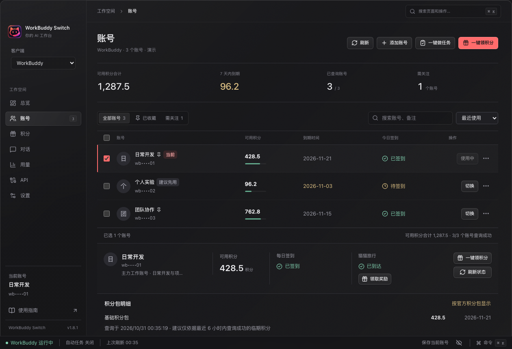
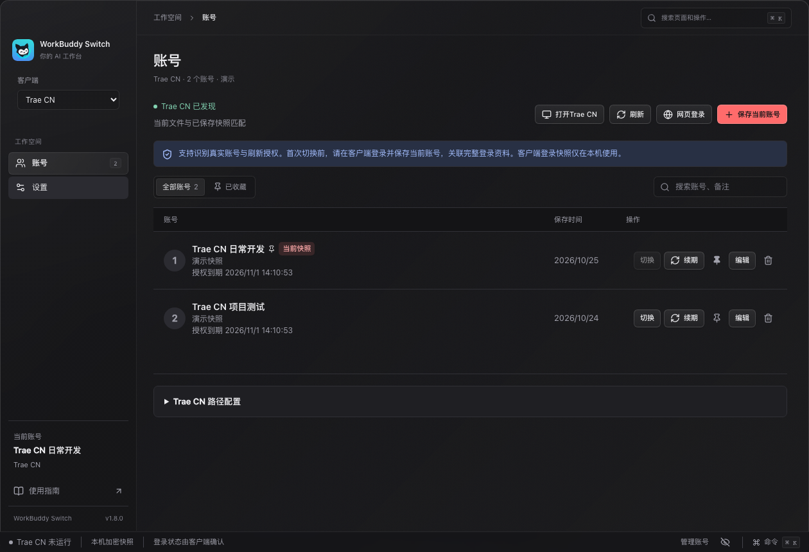
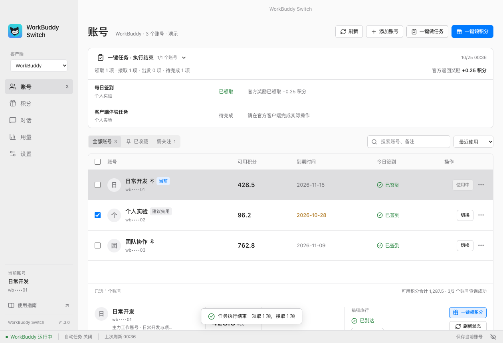
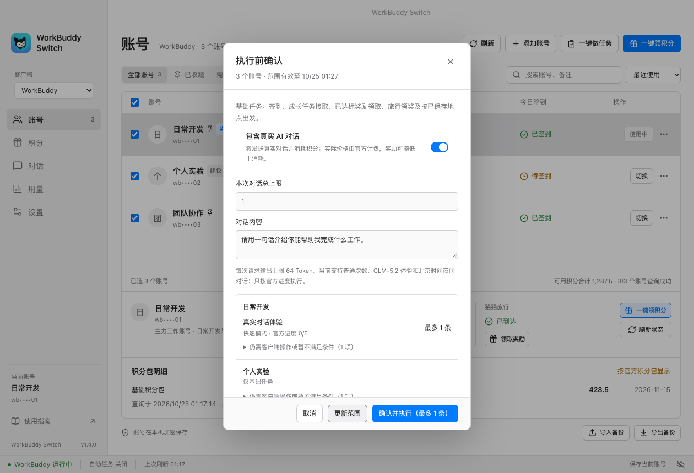
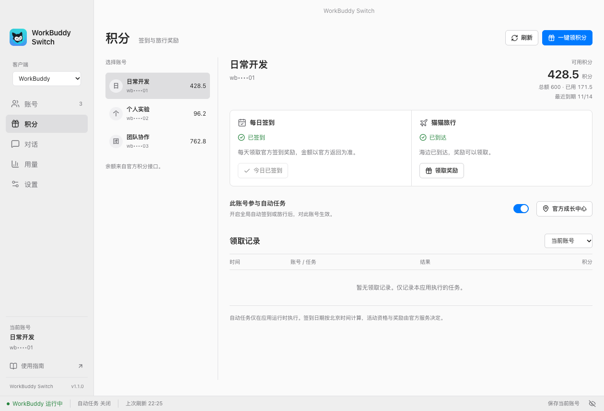
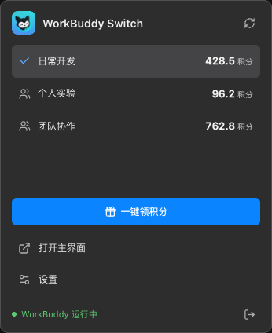
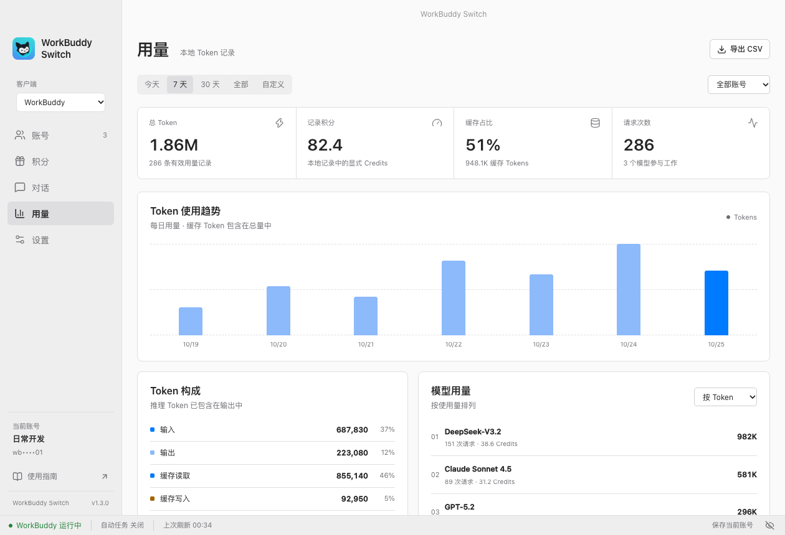
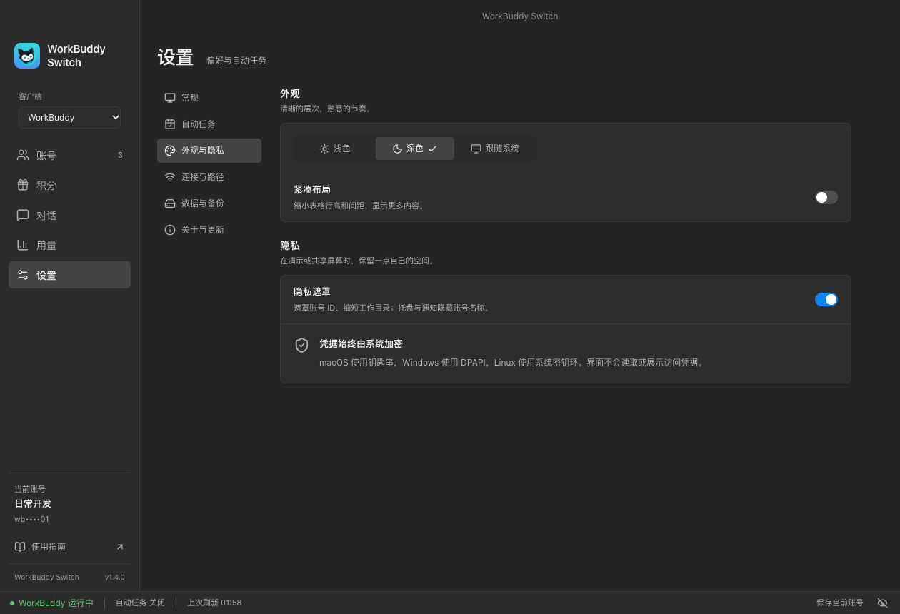

<div align="center">
  
  <h1>WorkBuddy Switch</h1>
  <p>管理 WorkBuddy、Trae 与 Qoder 的国内和国际版，支持 macOS、Windows 与 Linux。<br />一键做任务 · 一键领积分 · 猫猫旅行 · 安全切换 · 对话续接</p>
  <p>
    <a href="https://github.com/koi128bit/WorkBuddy-Switch/releases/latest">下载应用</a> ·
    <a href="https://github.com/koi128bit/WorkBuddy-Switch/wiki">使用指南</a> ·
    <a href="CHANGELOG.md">更新日志</a> ·
    <a href="https://github.com/koi128bit/WorkBuddy-Switch/issues">反馈问题</a>
  </p>
  <p>
    
    
    <a href="LICENSE"></a>
  </p>
</div>

<p align="center"></p>

WorkBuddy Switch 1.6.2 在同一个简洁灰阶界面中管理 WorkBuddy、Trae 和 Qoder，提供六个独立客户端入口。客户端各自保留独立账号列表，支持浅色、深色、跟随系统和紧凑布局；原来的猫咪图标继续保留。主窗口和菜单栏都可以选择客户端，底部状态栏随所选客户端更新。

> 截图均为演示账号和模拟数据。真实积分、任务资格与奖励以官方接口为准，本地用量来自设备上的记录。

## 支持的客户端

| 客户端            | 账号功能                                                   | 其他功能                                                       |
| ----------------- | ---------------------------------------------------------- | -------------------------------------------------------------- |
| WorkBuddy 国内版  | 保存当前登录、官方网页登录、刷新授权、切换、跨设备加密备份 | 官方积分、一键做任务、签到与旅行领奖、自动任务、本地对话与用量 |
| WorkBuddy 国际版  | 独立账号库与官方授权、切换、积分查询、跨设备加密备份       | 独立本地对话与用量；活动不调用国内版接口                       |
| Trae CN / 国际版  | 真实 UID 识别、官方网页登录、授权续期、完整登录快照切换    | 备注、收藏、搜索、托盘切换、切换失败恢复                       |
| Qoder CN / 国际版 | 真实 UID 识别、官方网页登录、授权续期、完整登录快照切换    | 备注、收藏、搜索、托盘切换、切换失败恢复                       |

产品、地区和本机操作系统分别适配，账号库、授权域名、应用标识及数据目录隔离。当前支持桌面客户端；Qoder IDE 插件、独立 CLI、Trae SOLO 使用不同的程序和登录目录，不共用桌面快照。

Trae / Qoder 网页授权与客户端登录资料分别加密保存，用同地区真实 UID 关联。**网页登录不会直接替换桌面登录。** 首次切换前，在官方客户端登录该账号并点击「保存当前账号」一次。未关联完整客户端资料的账号会显示待关联，并禁用切换，避免拼接另一账号的资料导致退登。

客户端格式暂不能识别时，可保留兼容快照；此时不把手填名称当成已验证身份。恢复成功只代表本机登录文件检查通过，最终登录状态由官方客户端与服务器确认。

## WorkBuddy 功能

| 页面     | 功能                                                                                 |
| -------- | ------------------------------------------------------------------------------------ |
| **账号** | 官方网页登录添加、保存当前登录、搜索、收藏、备注、排序、多选领取、安全切换和加密备份 |
| **积分** | 一键做任务、每日签到、猫猫旅行、成长任务进度、按账号配置自动任务和执行结果           |
| **对话** | 搜索本地记录、按账号筛选、恢复回收站对话、迁移到当前账号继续                         |
| **用量** | Token 分项、模型与对话排行、日期范围、日志 Credits 与 CSV 导出                       |
| **设置** | 常规、自动任务、外观与隐私、连接与路径、数据与备份、关于与更新                       |

WorkBuddy 账号页提供「需关注」筛选，集中显示查询失败、凭据待续期、低余额与临期积分。积分包明细展示各包可用量和到期时间；「建议先用」仅依据最近 6 小时内查询成功的临期积分，不会自动切换账号。

底部状态栏显示当前客户端的运行状态、自动任务开关、正在执行的操作和积分刷新时间，并提供保存当前账号与隐私遮罩快捷操作。

## Trae 与 Qoder 账号

<p align="center"></p>

1. 在侧栏的「客户端」选择 对应产品的国内版或国际版。
2. 在对应官方客户端登录账号 A，回到本应用点击 **保存当前账号**，填写容易辨认的名称；应用会尝试识别真实 UID。
3. 在官方客户端登录账号 B 后再次保存。之后在列表或菜单栏选择目标账号，确认切换。
4. 自定义安装位置可在账号页的 **路径配置**，或「设置 → 连接与路径」中指定。Windows 的 Qoder CN 支持读取官方启动器位置。

切换前正常退出目标客户端、保存切换前的登录快照，再恢复目标登录。只处理明确的登录字段或登录文件，保留设置、插件、工作区、对话、机器标识与其他客户端的状态。失败时尝试恢复原登录；中断后的加密恢复记录可通过 **恢复切换前登录** 处理。检测到后续新登录时，会停止恢复以保护新登录；此时可选择「保留当前登录并归档」，保存当前快照并归档旧恢复记录，再继续切换。

产品和地区分别校验。客户端升级导致格式变化时请重新保存快照。客户端格式只做只读核验，尚未使用用户真实账号执行 Trae / Qoder 切换；测试使用隔离文件、模拟接口和原生主机。

## 一键做任务

<p align="center"></p>

在 **WorkBuddy 国内版 → 账号** 勾选账号，点击 **一键做任务**；积分页也可对当前选中的账号执行。先查看确认窗口，再决定执行范围。

<p align="center"></p>

- **一次确认，连续处理**：接取任务 → 执行动作 → 等待官方计分 → 达标领奖 → 继续已确认范围内新解锁的任务。范围绑定账号、内容、模型、专家资源和次数，10 分钟有效、仅使用一次。
- **真实对话任务**：普通对话、GLM-5.2、夜间对话、桌面对话、专家、专家团、腾讯轻量云等指定专家，以及已安装技能。专家来自官方市场，使用实际服务端请求标识记录活动。
- **活动事件任务**：资料库、主题、自动化、发现应用等可通过兼容活动上报推进；模板、灵感、画布和技能体验还会发送真实对话，计入对话上限。主题任务会应用官方主题，可在官方客户端改回。不会生成实际画布、建立长期定时任务或授予第三方应用权限；服务端仍可能要求实际客户端操作。确认框分别显示纯活动操作和真实对话次数。
- **消耗控制**：默认总上限 80 条，可调为 1–200 条，每账号最多 40 条；单次请求输出上限 64 Token。实际积分按官方计费，无法保证奖励覆盖消耗。进度不推进、结果不明或调用失败时停止该账号后续对话，不自动重发付费请求。每次最多预览 20 个账号的体验任务。
- **进度与停止**：显示等待计分、活动记录、真实对话、领奖和逐项结果。停止后保留已完成结果；公众号关注、协议确认、捐款、夜间时间条件或尚未支持的任务逐项说明原因。

积分和能量只统计官方明确返回的奖励，活动请求成功不等于任务已完成。本轮会继续处理已确认范围内的前置解锁关系；范围外的新对话任务需要再次确认。此功能限 WorkBuddy 国内版，不改变设置中的定时任务范围。

最近一批记录保存在本机，异常退出会标记为中断；再次执行前重新查询官方状态。记录不含完整对话文本或凭据，损坏记录备份保留。功能通过隔离账号、模拟接口及原生系统检查；真实账号的所有任务计分和对话扣费尚未逐项验收，不承诺绕过关注关系、付款、协议或服务端限制。

## 一键领积分与猫猫旅行

<p align="center"></p>

- **一键领取**：在账号列表勾选账号，点击「一键领积分」。先查询官方状态，再完成未签到账号的每日签到，并领取已经到达的旅行奖励。账号详情和菜单栏也提供快捷领取。
- **旅行出发**：在积分页选择官方提供的地点，点击「出发」。旅行中、已到达和今日次数已用完分别展示；到达前不会按本地倒计时提前领奖。
- **自动任务**：在「设置 → 自动任务」分别开启自动签到、旅行领奖和旅行出发，设置签到时间与检查间隔。各账号可单独退出自动任务；自动出发需要预先选择地点。
- **领取记录**：保存本应用执行的签到、旅行和出发结果。官方未返回奖励金额时显示「未返回金额」，不推测或补造积分；失败不会计入成功领取。

签到与旅行目前适用于国内版账号，并受官方活动开放情况和账号资格限制。自动任务默认关闭，只有应用运行且电脑未休眠时才执行；关闭到菜单栏或托盘后可继续运行，完全退出后停止。签到时间按北京时间计算，到达设置时间后在下一次检查中执行。

在 Trae / Qoder 账号行点击「续期」可更新已识别的授权；这不会将网页 token 拼接到另一个人的客户端资料。要更新桌面快照，请在客户端正常登录后重新保存。

## 菜单栏与系统托盘

<p align="center"></p>

点击猫咪图标，先选择客户端，即可查看其最近使用的账号、切换账号，或打开主界面与设置。WorkBuddy 还可查看缓存积分及一键领取。macOS 可在菜单栏图标旁显示当前账号的积分数字；Windows 和 Linux 使用系统托盘。隐私遮罩默认隐藏面板中的账号昵称，截图展示的是关闭昵称遮罩后的演示效果。

快捷键：`⌘ / Ctrl + ,` 打开设置，`⌘ / Ctrl + 1` 显示主窗口，`⌘ / Ctrl + Shift + M` 打开快捷面板。

## 下载与安装

从 [GitHub Releases](https://github.com/koi128bit/WorkBuddy-Switch/releases/latest) 下载，校验清单为同页的 `SHA256SUMS.txt`。

| 系统              | 1.6.2 安装包                                                                                                                                                                                                                                                                            |
| ----------------- | --------------------------------------------------------------------------------------------------------------------------------------------------------------------------------------------------------------------------------------------------------------------------------------- |
| Apple Silicon Mac | [覆盖安装 PKG](https://github.com/koi128bit/WorkBuddy-Switch/releases/download/v1.6.2/WorkBuddy-Switch-1.6.2-mac-arm64.pkg) · [DMG](https://github.com/koi128bit/WorkBuddy-Switch/releases/download/v1.6.2/WorkBuddy-Switch-1.6.2-mac-arm64.dmg)                                        |
| Intel Mac         | [覆盖安装 PKG](https://github.com/koi128bit/WorkBuddy-Switch/releases/download/v1.6.2/WorkBuddy-Switch-1.6.2-mac-x64.pkg) · [DMG](https://github.com/koi128bit/WorkBuddy-Switch/releases/download/v1.6.2/WorkBuddy-Switch-1.6.2-mac-x64.dmg)                                            |
| Windows 10/11 x64 | [安装版 setup.exe](https://github.com/koi128bit/WorkBuddy-Switch/releases/download/v1.6.2/WorkBuddy-Switch-1.6.2-windows-x64-setup.exe) · [便携版 portable.exe](https://github.com/koi128bit/WorkBuddy-Switch/releases/download/v1.6.2/WorkBuddy-Switch-1.6.2-windows-x64-portable.exe) |
| Linux x64         | [AppImage](https://github.com/koi128bit/WorkBuddy-Switch/releases/download/v1.6.2/WorkBuddy-Switch-1.6.2-linux-x86_64.AppImage) · [DEB](https://github.com/koi128bit/WorkBuddy-Switch/releases/download/v1.6.2/WorkBuddy-Switch-1.6.2-linux-amd64.deb)                                  |
| Linux ARM64       | [AppImage](https://github.com/koi128bit/WorkBuddy-Switch/releases/download/v1.6.2/WorkBuddy-Switch-1.6.2-linux-arm64.AppImage) · [DEB](https://github.com/koi128bit/WorkBuddy-Switch/releases/download/v1.6.2/WorkBuddy-Switch-1.6.2-linux-arm64.deb)                                   |

Linux 需要桌面图形环境及已解锁的系统密钥环；AppImage 需要执行权限和对应系统的 FUSE 支持。WorkBuddy 国内版 Linux 由 UOS / 麒麟商店提供，其他客户端也以厂商当前发布的系统与架构版本为前提。自动发现失败时可手动选择应用及数据根目录。

macOS 推荐双击 **PKG 覆盖安装包**，固定替换 `/Applications/WorkBuddy Switch.app`，安装前要求退出正在运行的旧版。DMG 中的应用从临时位置启动时也会提供安装并替换；检测到已安装更新版本时打开已安装版，不直接降级。账号、设置和记录继续使用原数据目录。

Windows 推荐 **setup.exe 安装版**，自动使用原安装记录和位置覆盖升级，应用与卸载入口名称固定，不再选择另一个安装目录。便携版为独立可执行文件，需要自行覆盖原文件，不等同于覆盖安装。

macOS 包使用 ad-hoc 签名，尚未做 Apple 公证；Windows 包尚未做 Authenticode 签名。首次打开可能提示未知发布者，处理方式见 [安装指南](https://github.com/koi128bit/WorkBuddy-Switch/wiki/安装与首次启动)。

### 升级后只保留一个已安装应用

新版沿用相同应用标识和数据目录。升级前先完成或停止正在执行的任务；从 1.5 起，应用会等待当前操作结束后再退出。安装不会删除账号库或设置，PKG 使用整包替换，移除应用包内的过时文件。

若此前直接从 DMG、下载目录或构建目录运行，安装后从「应用程序」打开，并推出旧的 DMG。历史下载文件不会被当作已安装版本自动清理。开发构建的 `.app` 位于隐藏的 `.build/` 目录，公开 `dist/` 只收集最终安装包，减少启动台识别重复构建副本。

### 第一个账号

1. 安装并登录 WorkBuddy 桌面客户端。
2. 打开 WorkBuddy Switch，点击底部状态栏的 **保存当前账号**。
3. 需要查询或领取积分时，点击账号页的 **添加账号**，在官方网页授权同一账号。
4. 点击 **刷新**，查询积分、签到与旅行状态。添加更多账号后，可多选领取或点击 **切换**。

切换前会确认并正常关闭 WorkBuddy，请先结束正在运行的任务。官方网页登录添加账号不会改变客户端的当前登录身份。

WorkBuddy 5.6 的部分凭据采用本机加密封装。应用原样保留该封装用于本机切换，不提取客户端内置密钥；官方网页登录授权用于积分、活动和密码加密的跨设备备份。

从 0.x 升级的 macOS 用户，可在「设置 → 数据与备份」点击 **迁入旧版 macOS 账号**。原文件与钥匙串条目会保留。详见 [账号指南](https://github.com/koi128bit/WorkBuddy-Switch/wiki/账号保存与快速切换)。

## 对话续接与备份

跨账号继续或恢复回收站对话时，应用会先正常退出 WorkBuddy，创建包含 WAL 的完整 SQLite 备份，然后在事务中只修改选中记录的归属与删除标记。检查通过后使用当前账号打开对话。国际版暂不调用未经确认的对话深链接，恢复后在客户端对话列表继续。

这是**本地对话归属迁移**：原账号不再拥有这条本地记录，不会生成副本，也不同步云端权限。项目目录与依赖仍需在本机可用。备份在应用数据目录的 `session-backups/`，默认保留最近 10 份，可在设置中调整。

客户端退出失败、交互式 CLI 尚在运行或记录状态已变化时，会停止写入。账号切换后启动失败会尝试恢复原登录；对话写入检查失败只撤销本次记录修改。详见 [对话指南](https://github.com/koi128bit/WorkBuddy-Switch/wiki/恢复与跨账号继续对话)。

## 用量口径

<p align="center"></p>

- **官方积分**：优先读取精确小数字段，排除已到期积分包，显示最近有效到期时间。查询失败明确提示，缓存不会冒充新结果。
- **本地 Token**：读取 `~/.workbuddy/projects/**/*.jsonl` 中 assistant 消息与工具调用的 usage，按记录 ID 去重。不同请求共用 trace ID 时仍分别计数，避免漏掉工具调用消耗。
- **记录 Credits**：只统计日志明确记录的积分，不按 Token 换算费用。它可能低于官方消耗，缺失记录时也可能为零。
- **时间与归属**：默认最近 7 天，可选择今天、30 天、全部或自定义日期；按本机时区和数据库中当前会话归属统计。迁移过的对话不会追溯原付费账号，无归属日志只计入「全部账号」。

```text
总 Token = 净输入 + 缓存读取 + 缓存写入 + 输出
         = prompt + completion
推理 Token 属于输出，不重复加入总量。
```

本地数据每 15 秒读取，官方积分默认每 5 分钟刷新，可关闭。详见 [Tokens、Credits 与额度](https://github.com/koi128bit/WorkBuddy-Switch/wiki/Tokens、Credits-与额度)。

## 设置与隐私

<p align="center"></p>

账号库使用系统 `safeStorage` 加密：macOS 由钥匙串保护，Windows 使用 DPAPI，Linux 使用 GNOME Keyring 或 KWallet。Linux 不接受 `basic_text` 降级，密钥环未解锁时拒绝保存和切换。Token 不传给界面，不写入操作日志。跨设备备份使用密码派生密钥与 AES-256-GCM；本机封装凭据需先通过官方网页登录重新授权，才能导出可移植备份。

本地历史与用量在设备上处理，应用不设置第三方统计或账号上传服务。启用并确认对话任务后，对话内容和该次已完成对话的活动记录发送到官方服务，用于回复与任务进度；完整文本不写入本机任务记录。其余网络用于官方登录、授权续期、积分与活动，以及手动检查本仓库 Releases。

隐私遮罩默认开启，会遮罩账号 ID、缩短工作目录，并隐藏菜单栏与通知里的昵称；主窗口中的账号名称和对话标题仍显示。详见 [SECURITY.md](SECURITY.md) 和 [隐私指南](https://github.com/koi128bit/WorkBuddy-Switch/wiki/数据、备份与隐私)。

## 本地开发

需要 Node.js **22.16+**，调试客户端功能需要安装相应客户端。测试使用独立目录和模拟凭据。

```bash
npm ci
npm run dev

npm test                 # 账号、签到、旅行、备份、用量和数据库
npm run test:desktop     # Electron 自带 Node 的后端兼容性
npm run build            # TypeScript 检查与界面构建
npm run test:smoke       # 主窗口、快捷面板、IPC、系统加密和设置
npx playwright install chromium
npm run test:ui          # 五页面交互、奖励、多选、主题与最小窗口

npm run dist:mac         # macOS 上构建 arm64 / x64 DMG 与 ZIP
npm run dist:win         # Windows 上构建 x64 安装版与便携版
npm run dist:linux       # Linux 上构建当前架构 AppImage 与 DEB
```

[GitHub Actions](https://github.com/koi128bit/WorkBuddy-Switch/actions/workflows/desktop.yml) 在macOS、Windows、Linux x64 与 Linux ARM64 四个原生 runner 上测试并打包，版本标签发布 Release 和 SHA-256 清单。项目结构见 [本地构建与贡献](https://github.com/koi128bit/WorkBuddy-Switch/wiki/本地构建与贡献)，界面与功能验收见 [design-qa.md](design-qa.md)。

## 许可

[MIT](LICENSE)。依赖许可见 [THIRD_PARTY_NOTICES.md](THIRD_PARTY_NOTICES.md)。本项目是独立社区工具，与 WorkBuddy、Trae 或 Qoder 官方没有隶属关系。
