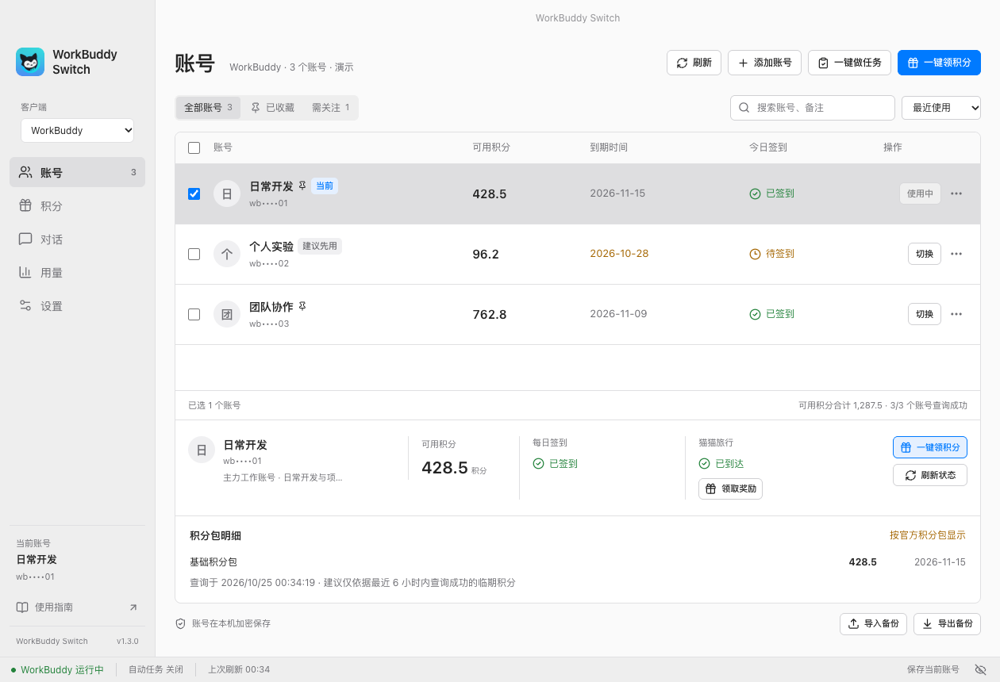
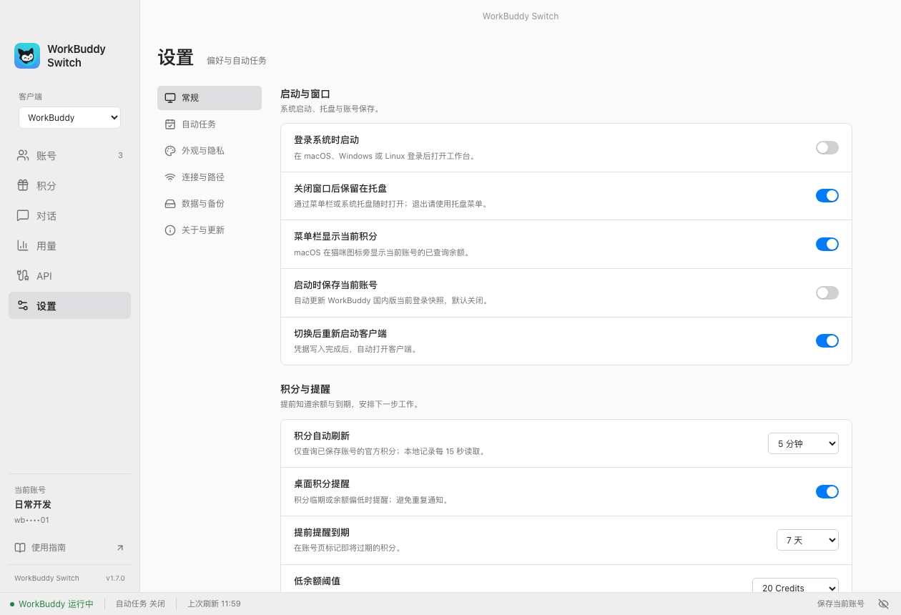

<div align="center">
  
  <h1>WorkBuddy Switch</h1>
  <p><strong>你的 WorkBuddy 多账号工作台。</strong><br />安全快切 · 积分与到期提醒 · 本地对话续接 · 用量分析</p>
  <p>
    <a href="https://github.com/koi128bit/WorkBuddy-Switch/releases/latest">下载最新版</a> ·
    <a href="https://github.com/koi128bit/WorkBuddy-Switch/wiki">使用指南</a> ·
    <a href="CHANGELOG.md">更新日志</a> ·
    <a href="https://github.com/koi128bit/WorkBuddy-Switch/issues">反馈问题</a>
  </p>
  <p>
    
    
    <a href="LICENSE"></a>
  </p>
</div>

<p align="center"></p>

把多个身份下的账号、积分和对话放在同一个桌面工作台里。WorkBuddy Switch 1.0 专注 WorkBuddy，支持 macOS 与 Windows；浅色、深色和紧凑布局都能保存为你的默认习惯。

> 截图使用演示账号与模拟数据。实际额度来自官方接口，用量来自你设备上的本地记录。

## 工作可以顺畅衔接

| 页面 | 可以做什么 |
| --- | --- |
| **工作台** | 查看当前身份、积分余额、临期账号、本地用量趋势，接着处理最近的对话 |
| **账号管理** | 保存当前登录，或通过官方网页登录添加；搜索、收藏、备注、排序，在主窗口或托盘切换 |
| **对话记录** | 按账号和关键词筛选本地对话；恢复回收站记录，或把选中对话迁移到当前账号继续 |
| **用量分析** | 按账号与时间查看 Token、模型分布、对话排行和日志中的 Credits，导出 CSV |
| **设置** | 配置系统启动、托盘、自动刷新、提醒、主题、隐私、路径、连接诊断与备份保留数量 |

<p align="center"></p>

## 下载与安装

从 [GitHub Releases](https://github.com/koi128bit/WorkBuddy-Switch/releases/latest) 获取安装包，并按需要对照同页的 `SHA256SUMS.txt`。

| 系统 | 1.0.0 安装包 |
| --- | --- |
| Apple Silicon Mac | [mac-arm64.dmg](https://github.com/koi128bit/WorkBuddy-Switch/releases/download/v1.0.0/WorkBuddy-Switch-1.0.0-mac-arm64.dmg) |
| Intel Mac | [mac-x64.dmg](https://github.com/koi128bit/WorkBuddy-Switch/releases/download/v1.0.0/WorkBuddy-Switch-1.0.0-mac-x64.dmg) |
| Windows 10/11 x64 | [安装版 setup.exe](https://github.com/koi128bit/WorkBuddy-Switch/releases/download/v1.0.0/WorkBuddy-Switch-1.0.0-windows-x64-setup.exe) · [便携版 portable.exe](https://github.com/koi128bit/WorkBuddy-Switch/releases/download/v1.0.0/WorkBuddy-Switch-1.0.0-windows-x64-portable.exe) |

macOS 打开 DMG 后，把 `WorkBuddy Switch.app` 拖到「应用程序」。Windows 运行安装程序，选择安装位置；便携版可直接运行，应用数据仍保存在当前系统用户的数据目录。

发布包采用 macOS ad-hoc 签名，未做 Apple 公证；Windows 包未做 Authenticode 签名。系统可能显示首次打开或未知发布者提示，处理方式见 [安装指南](https://github.com/koi128bit/WorkBuddy-Switch/wiki/安装与首次启动)。

### 保存你的第一个账号

1. 安装 WorkBuddy 桌面客户端，并完成登录。
2. 打开 WorkBuddy Switch，在「账号管理」点击 **保存当前账号**。
3. 如果需要查询积分或导出跨设备账号备份，点击 **网页登录添加**，在官方页面登录同一账号。
4. 添加第二个账号后，点击 **切换账号**。确认正在运行的任务已结束，再继续操作。

WorkBuddy 5.6 会将部分登录凭据保存在本机加密封装中。保存当前账号会原样保留该封装，用于本机切换；应用不会尝试提取客户端内置密钥。官方网页登录授权可用于积分查询和密码加密的跨设备备份，添加时不会改变客户端的当前身份。

从 0.x 升级的 macOS 用户，可以在「设置 → 数据与备份」选择 **迁入旧版 macOS 账号**。旧版文件和钥匙串条目会保留。详细步骤见 [账号指南](https://github.com/koi128bit/WorkBuddy-Switch/wiki/账号保存与快速切换)。

## 对话续接与安全备份

选中的对话属于其他账号或在回收站中时，应用会先提示，再正常退出 WorkBuddy、创建包含 WAL 的完整数据库备份，并在事务中只修改这条对话的归属与删除标记。验证完成后，使用当前账号打开对话。

这是**本地对话归属迁移**：原账号将不再拥有这条本地记录，不会创建一份副本，也不会同步云端权限。原目录和依赖仍需在本机可用。备份存放在本应用数据目录的 `session-backups/` 中，默认保留最近 10 份，可在设置中调整。

如果客户端退出失败、交互式 CLI 尚在运行或对话状态已变化，应用会停止写入。切换后的客户端启动失败会尝试恢复原登录信息；对话写入后的检查失败只撤销选中的记录，不替换整个正在使用的数据库。详情见 [恢复与跨账号继续对话](https://github.com/koi128bit/WorkBuddy-Switch/wiki/恢复与跨账号继续对话)。

## 用量要看清口径

<p align="center"></p>

- **官方积分**：读取 WorkBuddy 官方额度接口。优先使用精确小数字段，排除已到期积分包，显示最近的有效到期时间。查询失败会明确提示，缓存不会冒充新查询结果。
- **本地 Token**：读取 `~/.workbuddy/projects/**/*.jsonl` 的 assistant usage，按消息 ID 去重，按本地数据库中的会话归属映射账号。
- **记录 Credits**：只统计日志明确记录的积分，不按 Token 猜测费用。它可能低于官方周期消耗，缺失记录时也可能为零。
- **统计时间**：默认最近 7 天，可选今天、30 天、全部或自定义日期；日期按本机时区计算。本地数据每 15 秒读取，官方积分默认每 5 分钟刷新，可关闭。

```text
总 Token = 净输入 + 缓存读取 + 缓存写入 + 输出
         = prompt + completion
推理 Token 是输出的子集，不再重复加入总量。
```

账号筛选按**当前本地会话归属**统计，迁移过的对话不会追溯原始付费账号。没有数据库归属的日志只计入「全部账号」。详见 [Tokens、Credits 与额度](https://github.com/koi128bit/WorkBuddy-Switch/wiki/Tokens、Credits-与额度)。

## 设置与隐私

<p align="center"></p>

账号库使用 Electron `safeStorage` 加密：macOS 通过钥匙串保护，Windows 通过 DPAPI 保护。Token 不传给界面，也不会写入操作日志。跨设备账号备份使用密码派生密钥与 AES-256-GCM；WorkBuddy 的本机加密封装需要先通过网页登录重新授权，才能导出可移植的备份。

对话和用量在本机处理。应用不含遥测、广告或第三方账号上传服务。网络请求用于 WorkBuddy 官方登录、授权续期和积分查询，以及手动检查本仓库 GitHub Releases 的新版本。

隐私遮罩默认开启，会遮罩账号 ID、缩短工作目录，并隐藏托盘和通知中的账号名称；主窗口的账号名称与对话标题仍会显示。完整说明见 [SECURITY.md](SECURITY.md) 和 [数据、备份与隐私](https://github.com/koi128bit/WorkBuddy-Switch/wiki/数据、备份与隐私)。

## 本地开发

需要 Node.js **22.16+**。已安装并登录 WorkBuddy 的用户，可直接运行桌面开发模式；测试使用独立目录和模拟凭据。

```bash
npm ci
npm run dev
```

```bash
npm test                 # 账号、备份、积分、用量、SQLite 与网页登录逻辑
npm run test:desktop     # 使用 Electron 自带 Node 验证后端
npm run build            # TypeScript 检查与前端构建
npm run test:smoke       # 独立测试目录中的桌面启动、IPC、加密和设置验证
npx playwright install chromium
npm run test:ui          # 页面交互、键盘弹窗、主题和最小窗口布局
```

```bash
npm run dist:mac         # 在 macOS 构建 arm64 / x64 DMG 与 ZIP
npm run dist:win         # 在 Windows 构建 x64 安装版与便携版
```

GitHub Actions 在 macOS 与 Windows 上构建发布包，版本标签通过同一流程发布 Release 和校验清单。项目结构、贡献与验收记录见 [本地构建与贡献](https://github.com/koi128bit/WorkBuddy-Switch/wiki/本地构建与贡献) 和 [design-qa.md](design-qa.md)。

## 许可

[MIT](LICENSE)。依赖许可见 [THIRD_PARTY_NOTICES.md](THIRD_PARTY_NOTICES.md)。本项目为独立社区工具，与 WorkBuddy 官方没有隶属关系。
