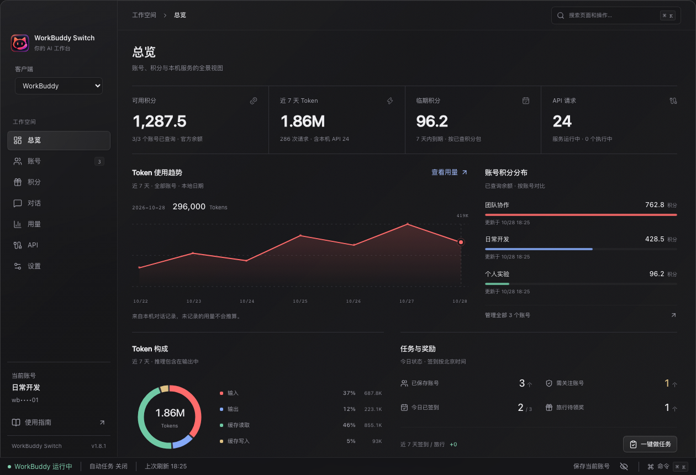
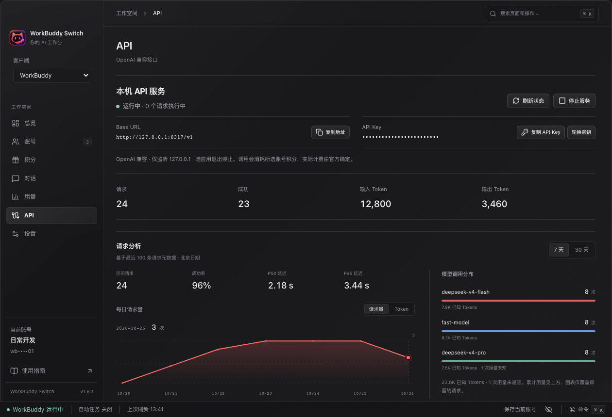

<div align="center">
  
  <h1>WorkBuddy Switch</h1>
  <p><strong>把账号、积分、对话和本机 API，放进一个桌面工作台。</strong></p>
  <p>WorkBuddy · Trae · Qoder ｜ 国内版与国际版 ｜ macOS · Windows · Linux</p>
  <p>
    <a href="https://github.com/koi128bit/WorkBuddy-Switch/releases/latest">下载最新版</a> ·
    <a href="https://github.com/koi128bit/WorkBuddy-Switch/wiki">使用指南</a> ·
    <a href="CHANGELOG.md">更新日志</a> ·
    <a href="https://github.com/koi128bit/WorkBuddy-Switch/issues">反馈问题</a>
  </p>
  <p>
    
    
    
    <a href="LICENSE"></a>
  </p>
</div>

> **强制署名与来源链接**
>
> 自 **1.9.6** 起，新增原创内容采用 **[WorkBuddy Switch Attribution License 1.0](LICENSE)**。对外分发该许可覆盖的内容、衍生应用，或用其提供服务时，**必须**在 README / 文档中标注 **WorkBuddy Switch**、原作者 **[koi128bit](https://github.com/koi128bit)** 和 **[原项目链接](https://github.com/koi128bit/WorkBuddy-Switch)**；具有用户界面的衍生应用与服务，还须在用户可访问的「关于 / 致谢 / 法律声明」中展示来源。
>
> 这是正式授权条件。**历史 MIT 授权和第三方许可继续有效，独立实现相同功能不因功能相似而受此许可约束。** 适用范围、展示方式和补正规则见 [来源标注与许可](#来源标注与许可)。

<p align="center"></p>

WorkBuddy Switch 是由 [koi128bit](https://github.com/koi128bit) 维护的独立社区桌面工具。统一的 Raycast Dark 工作台提供账号切换、积分任务、对话续接、用量分析和本机 API 转发，支持三个产品、两个地区的六个独立客户端入口。

截图均为演示账号与模拟数据。功能以所下载版本的 [发布说明](https://github.com/koi128bit/WorkBuddy-Switch/releases) 为准；官方积分、奖励、模型权限和任务资格以官方服务返回为准。

[功能概览](#功能概览) · [下载安装](#下载安装) · [快速开始](#快速开始) · [本机 API](#本机-api) · [来源标注与许可](#来源标注与许可) · [本地开发](#本地开发)

## 功能概览

| 能力 | 你可以做什么 |
| --- | --- |
| **多账号管理** | 保存当前登录、官方网页登录授权、搜索、收藏、备注、排序、安全切换与跨设备加密备份 |
| **积分与任务** | 查询可用及临期积分，一键做任务、每日签到、猫猫旅行、领奖与按账号配置自动任务 |
| **对话续接** | 搜索本地记录、恢复回收站对话，将选中记录迁移至当前账号继续 |
| **用量分析** | 查看 Token 趋势、缓存构成、模型消耗、每日明细、API 用量与 CSV 导出 |
| **本机 API** | 将已授权的 WorkBuddy 账号接入 OpenAI / Anthropic 兼容接口，管理账号池与实时模型目录 |
| **桌面快捷操作** | 菜单栏 / 系统托盘切换、快捷领奖、命令搜索、隐私遮罩、原生毛玻璃与紧凑布局 |

### 支持的客户端

| 客户端 | 账号与授权 | 专属能力 |
| --- | --- | --- |
| **WorkBuddy 国内版** | 保存登录、网页登录、续期、切换、加密备份 | 积分、签到、旅行、任务、本地对话、用量与 API 转发 |
| **WorkBuddy 国际版** | 独立账号库、官方授权、切换、加密备份 | 独立本地对话、用量与 API 转发；活动不调用国内版接口 |
| **Trae CN / 国际版** | 真实 UID 识别、网页登录、续期、完整登录快照切换 | 备注、收藏、搜索、托盘切换与失败恢复 |
| **Qoder CN / 国际版** | 真实 UID 识别、网页登录、续期、完整登录快照切换 | 备注、收藏、搜索、托盘切换与失败恢复 |

产品、地区和操作系统分别适配，账号库、授权域名、应用标识与数据目录隔离。支持范围是桌面客户端；Qoder IDE 插件、独立 CLI 和 Trae SOLO 使用不同的程序与登录目录。

## 下载安装

前往 **[GitHub Releases 下载最新版](https://github.com/koi128bit/WorkBuddy-Switch/releases/latest)**，在 Assets 中选择对应系统与架构的文件。每次发布附带 `SHA256SUMS.txt`，可用于校验下载文件。

| 系统 | 推荐文件 | 其他选择 |
| --- | --- | --- |
| Apple Silicon Mac | `mac-arm64.pkg`，覆盖安装至「应用程序」 | `mac-arm64.dmg` |
| Intel Mac | `mac-x64.pkg`，覆盖安装至「应用程序」 | `mac-x64.dmg` |
| Windows 10 / 11 x64 | `windows-x64-setup.exe`，沿用原位置升级 | `windows-x64-portable.exe`，便携运行 |
| Linux x64 | `linux-amd64.deb` | `linux-x86_64.AppImage` |
| Linux ARM64 | `linux-arm64.deb` | `linux-arm64.AppImage` |

表中为安装包文件名后缀，完整名称以 `WorkBuddy-Switch-版本号-` 开头。

- **macOS**：支持 13 及以上。推荐 PKG，安装前先退出旧版；DMG 中的应用也提供安装与替换入口。安装后从 `/Applications/WorkBuddy Switch.app` 启动，并推出旧的 DMG。
- **Windows**：推荐安装版，沿用已有安装记录与位置。便携版需自行覆盖原文件。
- **Linux**：需要桌面图形环境与已解锁的系统密钥环；AppImage 还需执行权限及对应 FUSE 支持。目标官方客户端也需提供相应系统与架构版本；WorkBuddy 国内版 Linux 由 UOS / 麒麟商店提供。

升级沿用相同应用标识和数据目录，保留账号库、设置与记录。请先完成或停止运行中的任务；历史下载文件不会自动清理。从 0.x 升级的 macOS 用户，可在「设置 → 数据与备份」迁入旧版账号，原文件与钥匙串条目保留。

macOS 包使用 ad-hoc 签名，尚未做 Apple 公证；Windows 包尚未做 Authenticode 签名。首次启动提示及详细步骤见 [安装与首次启动](https://github.com/koi128bit/WorkBuddy-Switch/wiki/安装与首次启动)。

## 快速开始

### WorkBuddy

1. 安装并登录对应地区的 WorkBuddy 桌面客户端。
2. 打开 WorkBuddy Switch，在侧栏选择对应客户端，点击底部的 **保存当前账号**。
3. 需要查询积分、参与活动或使用 API 时，点击 **添加账号**，在官方网页授权同一账号。网页授权不会替换桌面客户端的当前登录。
4. 点击 **刷新**，查看积分与活动状态；保存更多账号后即可切换或多选操作。

切换前请结束客户端正在运行的任务。应用会确认并正常退出目标客户端、备份原登录，再恢复目标账号；失败时尝试恢复原登录。WorkBuddy 5.6 的本机加密凭据原样保存，不提取客户端内置密钥；可移植备份需要官方网页登录授权。

### Trae 与 Qoder

1. 选择产品与地区，在对应官方客户端登录账号 A，再点击 **保存当前账号**。
2. 在官方客户端登录账号 B 后再次保存，之后从列表或菜单栏选择账号切换。
3. 自定义安装位置可在账号页 **路径配置**，或「设置 → 连接与路径」指定。

**网页登录授权与桌面登录快照分别保存，并按同地区真实 UID 关联。** 未关联完整客户端资料的账号会显示待关联并禁用切换。只完成网页登录时，仍需在官方客户端登录该账号并保存一次；应用不会把网页 Token 拼接到其他账号的资料中。

切换仅处理明确的登录字段或文件，保留设置、插件、工作区、对话和机器标识。中断时可使用 **恢复切换前登录**；检测到后续新登录时会停止恢复，保护当前状态。客户端升级后如格式变化，请重新保存快照。无法识别身份的兼容快照不会将手填名称当作已验证 UID。

<p align="center"></p>

Trae / Qoder 的切换测试使用隔离文件、模拟接口与原生主机，尚未使用用户真实账号逐项验收；本机恢复检查通过不代表官方服务已确认登录。

## 积分、任务与猫猫旅行

在 **WorkBuddy 国内版 → 账号** 勾选账号，即可一键领积分或一键做任务；积分页提供当前账号的详细操作。

| 操作 | 执行方式 |
| --- | --- |
| **一键领积分** | 先查询官方状态，再完成未签到账号的签到，并领取已到达的旅行奖励 |
| **猫猫旅行** | 选择官方提供的地点出发，按官方状态区分旅行中、已到达与今日次数用完 |
| **一键做任务** | 预览并确认账号、任务、模型、内容与次数后，接取任务、执行、等待计分并领奖 |
| **自动任务** | 在「设置 → 自动任务」分别开启签到、旅行领奖与出发；各账号可单独退出 |

<p align="center"></p>

- **次数与消耗**：真实对话默认总上限 80 条，可调为 1–200 条，每账号最多 40 条，单次输出上限 64 Token。实际按官方计费，不能保证奖励覆盖消耗。
- **执行范围**：确认范围绑定账号、内容、模型、专家资源和次数，10 分钟有效且仅用一次；可继续处理范围内新解锁任务，范围外的新对话任务需要再次确认。
- **活动操作**：部分体验任务通过兼容活动上报推进，部分还会发送真实对话并计入上限。主题任务会应用官方主题；不会生成实际画布、建立长期定时任务或授予第三方应用权限，官方仍可能要求实际客户端操作。
- **停止与记录**：进度不推进、调用失败或结果不明时停止该账号后续对话，不自动重发付费请求；保留已完成结果，异常退出标记中断。未知进度不会当成完成。

自动任务默认关闭，仅在应用运行且电脑未休眠时执行，完全退出后停止；签到时间按北京时间计算。奖励只统计官方明确返回的金额，未返回金额单独标注。关注关系、付款、协议和时间条件等限制仍由官方决定，全部任务计分及扣费结果尚未逐项验收。

## 本机 API

在 **API** 页选择已完成官方网页登录授权的 WorkBuddy 账号，保存设置并启动服务，点击 **复制 API Key** 获取密钥。

```text
Base URL：http://127.0.0.1:8317/v1
API Key：从应用 API 页复制
```

| 接口 | 用途 |
| --- | --- |
| `GET /v1/models` | 获取当前账号可见的模型目录与精确模型 ID |
| `POST /v1/chat/completions` | OpenAI Chat Completions 兼容接口 |
| `POST /v1/responses` | OpenAI Responses 兼容接口 |
| `POST /v1/messages` | Anthropic Messages 兼容接口 |
| `POST /v1/embeddings` | 官方向量接口，支持 `bge-m3` 与 `hunyuan-embedding` |
| `POST /v1/tools/{agentic_search\|knowledge_search\|tempkey}` | 转发官方搜索与相关 Agent 工具接口 |

支持流式回复、工具调用、图片输入和实际用量记录。国内版优先读取个人模型目录，国际版优先读取官方桌面客户端的 `/v3/config` 当前目录，避免旧目录遗漏 Flash 等新模型。目录可见不代表账号具备 API 调用权限。Trae / Qoder 账号不参与转发。

国内版与国际版在 API 页同时展示：OpenAI / Codex 分别使用 `http://127.0.0.1:8317/cn/v1` 和 `http://127.0.0.1:8317/global/v1`；Claude Code 分别使用 `/cn` 和 `/global` 根地址。这些独立地址使用原始模型 ID，国内与国际账号、会话绑定互不混用。原统一 `/v1` 地址继续支持 `global:` 前缀。

<p align="center"></p>

- **账号调度**：刚确认积分为零的账号自动跳过；明确积分不足且未生成内容时，可切换同地区已选账号。
- **请求范围**：无额外本机并发或每分钟请求上限；消息上限 20000 条，请求体上限 32 MB。客户端指定的输出预算原样转发，未指定时使用官方默认值；实际仍受官方限流、模型上下文与账号权限约束。
- **异常处理**：系统指令保留 system 角色，不搬移到用户消息。官方渠道校验要求首条 system 消息的开头不能是第三方 Agent 身份，网关在命中 Codex CLI、Claude Code 等指纹时于同一条 system 消息前加一句中性引导语，原文逐字保留。连接中断、半截回复、渠道或权限拒绝不会自动换号重发。最近请求保留官方业务码、原始 HTTP 状态与请求规模，`11128` 渠道校验拒绝不会误报为授权 403。
- **统计与隐私**：API Token 用量按日、账号与模型并入用量页；服务仅监听本机，不记录对话正文。请求分析覆盖保留的最近 100 条，累计用量另列，未知用量不推算。

已用真实 OpenCode 验证部分模型的流式回复与工具调用闭环；官方 OpenAI / Anthropic SDK 契约 20/20 通过，Codex CLI 0.159.2 与 Claude Code 2.1.169 在国内版、国际版各跑通一轮工具调用闭环。其他 Agent、模型和账号组合需分别验证。配置示例、协议差异与使用范围见 **[本机 API 接入指南](docs/local-api.md)**。

## 对话续接与用量统计

**跨账号继续对话**会先正常退出 WorkBuddy，创建包含 WAL 的完整 SQLite 备份，再在事务中修改选中记录的归属与删除标记。这会迁移本地记录，原账号不再拥有该记录，不会生成副本或同步云端权限；项目目录与依赖仍需在本机可用。

备份位于应用数据目录的 `session-backups/`，默认保留最近 10 份，可在设置中调整。客户端退出失败、交互式 CLI 仍在运行或记录状态已变化时停止写入；检查失败会撤销本次修改。国际版恢复后从官方客户端对话列表继续。

**用量页**提供日期筛选、Token 构成、模型排行、每日明细与 CSV 导出。官方积分、日志 Credits 和本地 Token 分别展示：

- 官方积分直接查询官方服务，查询失败明确提示；缓存不会冒充新结果。
- 本地 Token 读取客户端日志并按记录 ID 去重，同时合并本机 API 用量；缓存和推理 Token 不重复计算。
- Credits 只统计日志明确记录的值，不按 Token 推算；缺失记录不代表没有发生费用。
- 数据按本机时区与当前本地会话归属统计，迁移对话不会追溯原付费账号；无归属日志仅计入「全部账号」。

<p align="center"></p>

本地数据每 15 秒读取，官方积分默认每 5 分钟刷新，可关闭。总览的积分汇总标明已查询账号数量；失败或未查询的数值保持未知。「建议先用」仅依据最近 6 小时内查询成功的临期积分，不会自动切换账号。

## 桌面体验与隐私

按 **`⌘ / Ctrl + K`** 打开命令搜索，**`⌘ / Ctrl + ,`** 打开设置，**`⌘ / Ctrl + 1`** 显示主窗口，**`⌘ / Ctrl + Shift + M`** 打开快捷面板。菜单栏 / 托盘可选择客户端、切换账号；WorkBuddy 还可查看缓存积分和快捷领奖。

macOS 使用原生背景模糊，Windows 11 22H2 及以上使用 Acrylic，其他系统保留兼容外观。可在「设置 → 外观与隐私」关闭毛玻璃；系统减少透明度和高对比度设置优先。

| 数据 | 处理方式 |
| --- | --- |
| **账号凭据** | 使用系统 `safeStorage`：macOS 钥匙串、Windows DPAPI、Linux GNOME Keyring / KWallet；Token 不传给界面，不写入操作日志 |
| **Linux 密钥环** | 不接受 `basic_text` 降级，密钥环未解锁时拒绝保存和切换 |
| **跨设备备份** | 密码派生密钥与 AES-256-GCM 加密，本机封装凭据需重新官方授权后才能导出可移植备份 |
| **本地数据** | 历史与用量在设备上处理，不设置第三方统计或账号上传服务 |
| **网络请求** | 官方登录、续期、积分与活动、API 转发，以及手动检查本仓库 Releases；确认执行的对话任务向官方发送对话与对应活动记录 |
| **隐私遮罩** | 默认遮罩账号 ID、缩短工作目录、隐藏菜单栏及通知昵称；主窗口账号名称与对话标题仍显示 |

详细边界见 [SECURITY.md](SECURITY.md) 与 [数据、备份与隐私](https://github.com/koi128bit/WorkBuddy-Switch/wiki/数据、备份与隐私)。

## 文档与反馈

| 文档 | 内容 |
| --- | --- |
| [使用指南](https://github.com/koi128bit/WorkBuddy-Switch/wiki) | 安装、账号管理、任务与日常使用 |
| [账号保存与快速切换](https://github.com/koi128bit/WorkBuddy-Switch/wiki/账号保存与快速切换) | 授权、快照、路径与切换恢复 |
| [恢复与跨账号继续对话](https://github.com/koi128bit/WorkBuddy-Switch/wiki/恢复与跨账号继续对话) | 对话迁移和备份 |
| [Tokens、Credits 与额度](https://github.com/koi128bit/WorkBuddy-Switch/wiki/Tokens、Credits-与额度) | 用量和积分口径 |
| [本机 API 接入](docs/local-api.md) | 接口、模型、OpenCode 配置与兼容范围 |
| [更新日志](CHANGELOG.md) | 各版本变更 |
| [功能与界面验收](design-qa.md) | 验收范围与验证记录 |

反馈问题请到 [Issues](https://github.com/koi128bit/WorkBuddy-Switch/issues)，附应用版本、操作系统、客户端及地区、复现步骤和已脱敏的错误信息。请勿提交账号 Token、API Key、完整凭据或未脱敏的对话记录。

## 来源标注与许可

### 当前许可证与历史授权

**WorkBuddy Switch Attribution License 1.0** 是自定义软件许可证，允许商业使用、修改、分发和提供服务，以保留版权、许可及可见的来源署名为条件；不要求公开衍生项目源码。它不是标准 MIT，也未宣称获得 OSI 认证。完整条款见 **[LICENSE](LICENSE)**。

| 内容 | 适用许可 |
| --- | --- |
| **1.9.6 及以后引入的新增原创代码、文档与素材** | 除另有标注外，适用 WorkBuddy Switch Attribution License 1.0 |
| **1.9.5 及以前版本、仓库提交 `bfa9b64` 及以前已按 MIT 提供的内容** | 继续适用原有 [MIT 授权](LICENSES/MIT-legacy.txt)，不因换证追溯增加限制；旧文件中的历史部分也保留原授权 |
| **第三方与单独授权的贡献** | 保留各自原有许可、作者和来源，见 [NOTICE](NOTICE) 与 [THIRD_PARTY_NOTICES.md](THIRD_PARTY_NOTICES.md) |
| **独立实现的同类功能、一般思想与操作方法** | 不因功能相似而纳入本许可证；仍欢迎自愿说明实际参考来源 |

### 强制署名要求

对外分发新许可覆盖的内容、实质部分或包含它的衍生作品时，必须：

1. 随附本许可证和适用的版权、历史及第三方许可声明。
2. 在主要 README 或随附文档中清晰标注 **WorkBuddy Switch**、**koi128bit** 和 **https://github.com/koi128bit/WorkBuddy-Switch**。
3. 有用户界面的应用，还须在可正常访问的「关于 / 致谢 / 法律声明」页面展示相同来源。使用新许可内容提供网络服务时，也须在服务界面或公开文档可到达的声明页面展示。
4. 支持超链接的展示位置必须提供可点击链接；纯文本环境保留完整 URL。无界面服务或命令行工具可使用公开文档或可访问的许可命令，无需为此另建图形界面。
5. 说明复用范围与修改，不将原项目或上游贡献冒充为独立原创，不暗示原作者为衍生产品背书。

改名、调整配色、部分重写、商业分发或闭源发布，不免除对仍包含的新许可内容的署名义务。仅写“来源于网络”“参考某开源项目”或隐藏、模糊化署名，不满足要求。私人使用且不分发或向他人提供服务时，无需建立公开署名页。

可按实际情况采用以下模板：

```markdown
本项目的【具体模块 / 功能 / 界面】基于
[WorkBuddy Switch](https://github.com/koi128bit/WorkBuddy-Switch)，
原作者为 [koi128bit](https://github.com/koi128bit)。
复用范围与修改：【说明实际复用部分及本项目的改动】。
其 1.9.6 起新增原创内容采用 WorkBuddy Switch Attribution License 1.0；
适用的历史 MIT 和第三方版权、许可声明一并保留。
```

### 违反与补正

上述要求是授权条件。未遵守的分发或服务须停止或立即改正，实质违约会导致相应新许可权利终止。首次违规在知悉后 30 天内完整补正，可按 LICENSE 自动恢复；逾期或再次违规需取得版权方书面同意。此规则不撤销历史 MIT 权限，不设置自动罚款，具体权利义务以 [LICENSE](LICENSE) 为准。

### 致谢与第三方来源

本机 API 互操作层参考了以下项目的协议文档和实现，相关作者、来源链接与原 MIT 许可保留在 [NOTICE](NOTICE)：

- [Sliverkiss / workbuddy2api](https://github.com/Sliverkiss/workbuddy2api)：NOTICE 记载的上游原项目。原始地址目前返回 404，仍保留原作者署名与来源记录。
- [linguo2625469 / workbuddy2api-panel](https://github.com/linguo2625469/workbuddy2api-panel)：协议文档与实现参考。

第三方依赖及许可见 [THIRD_PARTY_NOTICES.md](THIRD_PARTY_NOTICES.md)。WorkBuddy、Trae、Qoder 的名称与商标归各自权利人所有，本项目与其官方没有隶属关系，也不代表官方背书。

## 本地开发

需要 **Node.js 22.16+**；调试客户端相关功能时，需安装对应官方客户端。测试使用独立目录与模拟凭据。

```bash
git clone https://github.com/koi128bit/WorkBuddy-Switch.git
cd WorkBuddy-Switch
npm ci
npm run dev
```

```bash
npm test                 # 账号、任务、备份、API、用量与数据库测试
npm run test:desktop     # Electron 自带 Node 的后端兼容性
npm run build            # TypeScript 检查、界面构建与依赖许可
npm run test:smoke       # 原生窗口、托盘、IPC、系统加密与设置
npx playwright install chromium
npm run test:ui          # 页面交互、图表、奖励与窗口尺寸

npm run dist:mac         # 在 macOS 构建 arm64 / x64 安装包
npm run dist:win         # 在 Windows 构建 x64 安装版与便携版
npm run dist:linux       # 在 Linux 构建当前架构 AppImage 与 DEB
```

[GitHub Actions](https://github.com/koi128bit/WorkBuddy-Switch/actions/workflows/desktop.yml) 在 macOS、Windows、Linux x64 与 Linux ARM64 原生 runner 上测试并打包；版本标签触发 Release 与 SHA-256 清单发布。构建细节见 [本地构建与贡献](https://github.com/koi128bit/WorkBuddy-Switch/wiki/本地构建与贡献)。

图标透明母版为 `assets/icon-master.png`，macOS 可执行 `npm run icons:mac` 生成图标资源。提交贡献前请完成相关检查；涉及来源、协议或第三方代码时同步保留署名与许可。
